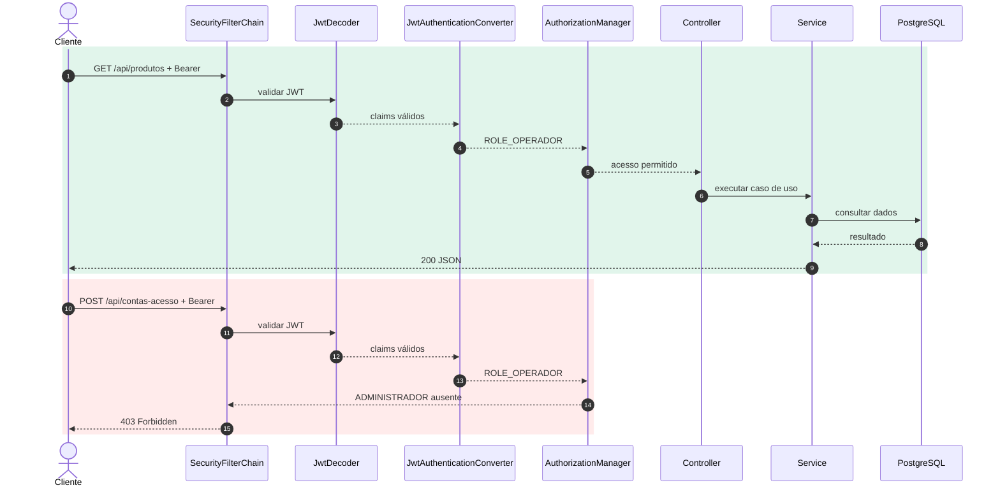
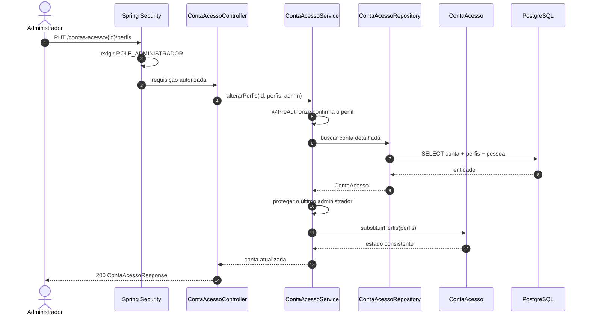
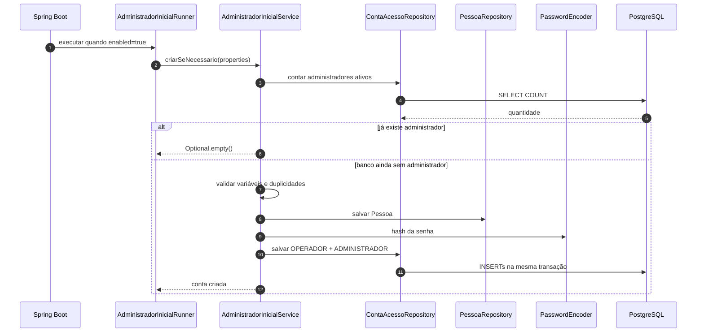

# Aula 14 — Autorização, perfis e controle de acesso

## Apresentação

Na Aula 13, a API passou a autenticar o cliente com Bearer Token JWT. O token comprova quem é o usuário e quais perfis a conta possuía no momento do login. Isso ainda não responde à pergunta central desta aula:

> A pessoa autenticada pode executar esta operação?

A partir da Aula 14, os perfis `OPERADOR` e `ADMINISTRADOR` passam a produzir decisões reais de acesso. O operador continua usando as funcionalidades cotidianas, mas não cria contas, não altera perfis, não bloqueia usuários e não exclui recursos. Essas operações ficam reservadas ao administrador.

O cadastro público provisório de pessoas e contas, usado nas Aulas 12 e 13, é removido. Para que um banco vazio ainda possa receber a primeira conta administrativa, a aplicação oferece um provisionamento por configuração externa, desativado por padrão.

### Problema orientador

> Como permitir que usuários autenticados executem somente as operações necessárias às suas responsabilidades, sem confiar em informações enviadas livremente pelo cliente?

### Escopo

Nesta aula:

- diferenciamos autenticação de autorização;
- estudamos perfis, authorities e permissões;
- aplicamos o princípio do menor privilégio;
- convertemos o claim `perfis` em authorities do Spring Security;
- definimos a política de `OPERADOR` e `ADMINISTRADOR`;
- protegemos rotas na cadeia HTTP e casos de uso com `@PreAuthorize`;
- implementamos criação de conta, alteração de perfis e alteração de status;
- impedimos que o último administrador ativo seja removido ou bloqueado;
- criamos o administrador inicial por variáveis de ambiente;
- testamos os resultados `200`, `201`, `400`, `401` e `403`;
- atualizamos OpenAPI, Postman e diagramas.

Ainda não fazem parte do escopo:

- permissões configuráveis no banco;
- grupos dinâmicos ou matriz ACL;
- refresh token, logout ou revogação;
- limite de tentativas de login;
- trilha de auditoria persistente;
- integração com provedor de identidade externo.

Esses limites preservam o objetivo da aula: compreender como uma identidade autenticada se transforma em uma decisão de autorização.

## Resultados de aprendizagem

Ao final desta aula, você deve ser capaz de:

- diferenciar identificação, autenticação e autorização;
- explicar a diferença entre perfil, authority e permissão;
- interpretar corretamente `401 Unauthorized` e `403 Forbidden`;
- justificar o princípio do menor privilégio;
- converter claims de um JWT em authorities do Spring Security;
- definir políticas por método HTTP e rota;
- aplicar defesa em profundidade com `@PreAuthorize`;
- administrar perfis e status sem remover o último administrador;
- provisionar uma identidade administrativa sem publicar senha no Git;
- testar decisões positivas e negativas de autorização;
- ler diagramas de sequência de autenticação e autorização.

## Pré-requisitos

- projeto da Aula 13 compilando e com os testes aprovados;
- PostgreSQL disponível para o profile de teste;
- Java 21;
- Maven Wrapper;
- `.env` local configurado e ignorado pelo Git;
- compreensão de `ContaAcesso`, `PerfilAcesso`, BCrypt e JWT;
- capacidade de realizar login e enviar um Bearer Token.

Confirme o ponto inicial:

```powershell
git status
git tag --points-at HEAD
.\mvnw.cmd test
```

O ponto de partida deve estar no marco `aula-13-jwt-bearer-token`. Não continue se houver alterações desconhecidas ou falhas anteriores.

## 1. Autenticação não é autorização

Três perguntas diferentes precisam ser separadas:

| Conceito | Pergunta | Evidência no projeto |
|---|---|---|
| Identificação | Quem a pessoa declara ser? | login enviado pelo cliente |
| Autenticação | A identidade foi comprovada? | senha validada e JWT assinado |
| Autorização | A identidade pode executar esta operação? | perfis convertidos em authorities e comparados com a política |

Um JWT válido comprova que o token foi emitido pelo servidor, não foi alterado, pertence a um sujeito e está dentro da validade. Isso não significa que o sujeito pode executar todas as operações.

```text
Token válido + perfil suficiente     → operação autorizada
Token válido + perfil insuficiente   → 403 Forbidden
Token ausente, inválido ou expirado  → 401 Unauthorized
```

### 1.1 Por que o nome `401 Unauthorized` confunde?

Apesar do nome histórico, `401` representa ausência de autenticação válida. A resposta normalmente informa como o cliente pode se autenticar por meio do cabeçalho `WWW-Authenticate`.

O `403` significa que a identidade foi estabelecida, mas a política não permite a operação. Repetir a mesma requisição com o mesmo perfil não resolve o problema.

### 1.2 Perfil, authority e permissão

No domínio, os perfis são valores compreensíveis para o negócio:

```java
public enum PerfilAcesso {
    OPERADOR,
    ADMINISTRADOR
}
```

Dentro do Spring Security, uma **authority** é uma string concedida à autenticação. Por convenção, `hasRole("ADMINISTRADOR")` procura a authority `ROLE_ADMINISTRADOR`.

| Domínio | Claim no JWT | Authority no Spring | Expressão |
|---|---|---|---|
| `OPERADOR` | `"OPERADOR"` | `ROLE_OPERADOR` | `hasRole('OPERADOR')` |
| `ADMINISTRADOR` | `"ADMINISTRADOR"` | `ROLE_ADMINISTRADOR` | `hasRole('ADMINISTRADOR')` |

O prefixo `ROLE_` é uma convenção da infraestrutura de segurança. Ele não contamina o enum do domínio nem o JSON do token.

## 2. RBAC e menor privilégio

O modelo desta aula é uma forma simples de **Role-Based Access Control — RBAC**. Permissões são agrupadas em papéis, e as contas recebem um ou mais desses papéis.

```text
Conta → Perfil → conjunto de operações autorizadas
```

O princípio do menor privilégio determina que uma identidade receba somente os acessos necessários para sua função. Uma conta usada diariamente para registrar vendas não precisa administrar usuários nem excluir cadastros.

### 2.1 Política adotada

| Operação | Público | OPERADOR | ADMINISTRADOR |
|---|:---:|:---:|:---:|
| health check | ✓ | ✓ | ✓ |
| OpenAPI e Swagger | ✓ | ✓ | ✓ |
| login | ✓ | ✓ | ✓ |
| consultar e operar recursos do negócio | — | ✓ | ✓ |
| consultar e alterar a própria senha | — | ✓ | ✓ |
| criar conta | — | — | ✓ |
| alterar perfis | — | — | ✓ |
| ativar ou bloquear conta | — | — | ✓ |
| excluir recursos | — | — | ✓ |

O `ADMINISTRADOR` também recebe `OPERADOR`, por isso pode executar as atividades cotidianas. Na primeira conta administrativa, a composição é explícita: o construtor cria `OPERADOR` e o provisionamento concede `ADMINISTRADOR`.

### 2.2 Política não é interface

Esconder um botão na interface web melhora a experiência, mas não protege a API. Um cliente pode construir a requisição manualmente com cURL ou Postman. A decisão precisa ocorrer no servidor.

## 3. Diagramas de sequência

Diagramas de sequência representam participantes na horizontal e mensagens ao longo do tempo. Eles ajudam a localizar onde uma decisão acontece e quem é responsável por ela.

Os quatro diagramas desta aula são interativos e abrem no navegador:

- [Login e emissão do JWT](diagramas/login-jwt.html);
- [Autorização de uma requisição JWT](diagramas/autorizacao-jwt.html);
- [Administração de perfis e status](diagramas/administracao-perfis.html);
- [Administrador inicial](diagramas/administrador-inicial.html).

### 3.1 Login e emissão do JWT

O login continua sendo o fluxo da Aula 13. A diferença é que as authorities `ROLE_*` já validadas pelo Spring Security são convertidas em claim `perfis`. O token emitido será a base das decisões de autorização.

```mermaid
sequenceDiagram
    autonumber
    actor Cliente
    participant Controller as AutenticacaoController
    participant Service as AutenticacaoService
    participant Manager as AuthenticationManager
    participant Details as UserDetailsService
    participant Banco as PostgreSQL
    participant Token as TokenService
    participant Encoder as JwtEncoder

    Cliente->>Controller: POST /api/autenticacao/login
    Controller->>Service: autenticar(login, senha)
    Service->>Manager: authenticate(credentials)
    Manager->>Details: loadUserByUsername(login)
    Details->>Banco: consultar conta, hash e perfis
    Banco-->>Details: ContaAcesso
    Details-->>Manager: UserDetails + ROLE_*
    Manager-->>Service: Authentication autenticado
    Service->>Token: emitir(authentication)
    Token->>Encoder: assinar claims
    Encoder-->>Token: JWT assinado
    Token-->>Controller: TokenAcesso
    Controller-->>Cliente: 200 TokenResponse
```

Leitura passo a passo:

1. a senha chega somente ao endpoint de login;
2. o `AuthenticationManager` coordena a validação;
3. o `UserDetailsService` recupera hash, status e perfis;
4. o `PasswordEncoder` compara a senha sem descriptografar o hash;
5. os perfis pertencem à conta carregada do banco e não são escolhidos pelo cliente;
6. somente após o sucesso o `TokenService` emite o JWT.

### 3.2 Requisição autorizada e requisição proibida



Observe que o segundo token é válido. O resultado é `403`, não `401`, porque a autenticação foi estabelecida e somente a autorização falhou. O controller não é executado.

### 3.3 Administração de perfis



Há duas verificações complementares:

- a cadeia HTTP impede que a chamada chegue ao controller;
- `@PreAuthorize` protege o caso de uso se ele for chamado por outra entrada futura.

Esse modelo é chamado de **defesa em profundidade**.

### 3.4 Administrador inicial



O provisionamento não é um endpoint público. Ele depende de configuração do ambiente e deve ser desligado depois da primeira execução.

## 4. Mapeamento teoria–prática

| Conceito | Implementação | Evidência |
|---|---|---|
| autenticação | `JwtDecoder` valida o token | token ausente ou inválido retorna `401` |
| authority | claim `perfis` convertido para `ROLE_*` | OPERADOR acessa rota cotidiana |
| autorização | regras em `SecurityFilterChain` | OPERADOR recebe `403` na administração |
| defesa em profundidade | `@PreAuthorize` no service | chamada ao caso de uso também exige ADMINISTRADOR |
| menor privilégio | criação e gestão de contas reservadas | token OPERADOR não administra usuários |
| configuração externa | administrador inicial no `.env` | banco vazio recebe a primeira conta sem senha no Git |
| invariantes administrativas | proteção do último administrador | bloqueio ou remoção indevida retorna `400` |

## 5. Ponto de quebra 1 — Converter perfis em authorities

Na Aula 13, o JWT já possuía:

```json
{
  "sub": "operador",
  "perfis": ["OPERADOR"]
}
```

O Resource Server valida o token, mas o conversor padrão procura scopes. É preciso indicar que a origem das authorities é o claim `perfis`.

```java
@Bean
public JwtAuthenticationConverter jwtAuthenticationConverter() {
    JwtGrantedAuthoritiesConverter authoritiesConverter =
            new JwtGrantedAuthoritiesConverter();
    authoritiesConverter.setAuthoritiesClaimName("perfis");
    authoritiesConverter.setAuthorityPrefix("ROLE_");

    JwtAuthenticationConverter authenticationConverter =
            new JwtAuthenticationConverter();
    authenticationConverter.setJwtGrantedAuthoritiesConverter(
            authoritiesConverter);
    return authenticationConverter;
}
```

Para o claim `OPERADOR`, o resultado é `ROLE_OPERADOR`. O conversor é conectado ao Resource Server:

```java
.oauth2ResourceServer(oauth2 -> oauth2
        .jwt(jwt -> jwt.jwtAuthenticationConverter(
                jwtAuthenticationConverter)))
```

### O que o conversor não faz

- não consulta o banco novamente;
- não aceita perfis enviados no corpo da requisição;
- não altera o token;
- não renova a validade;
- não substitui a política de autorização.

Ele apenas transforma claims já validados em authorities compreendidas pelo Spring Security.

## 6. Ponto de quebra 2 — Definir a política HTTP

A segurança de métodos é habilitada na configuração:

```java
@Configuration
@EnableMethodSecurity
@EnableConfigurationProperties(AdministradorInicialProperties.class)
public class SecurityConfig {
```

As regras são organizadas da mais específica para a mais geral:

```java
.authorizeHttpRequests(authorize -> authorize
    .requestMatchers(
        "/api/health",
        "/v3/api-docs/**",
        "/v3/api-docs.yaml",
        "/swagger-ui.html",
        "/swagger-ui/**")
    .permitAll()
    .requestMatchers(HttpMethod.POST, "/api/autenticacao/login")
    .permitAll()
    .requestMatchers(HttpMethod.POST, "/api/contas-acesso")
    .hasRole("ADMINISTRADOR")
    .requestMatchers(
        "/api/contas-acesso/*/perfis",
        "/api/contas-acesso/*/status")
    .hasRole("ADMINISTRADOR")
    .requestMatchers(HttpMethod.DELETE, "/api/**")
    .hasRole("ADMINISTRADOR")
    .requestMatchers("/api/**")
    .hasAnyRole("OPERADOR", "ADMINISTRADOR")
    .anyRequest()
    .denyAll())
```

Rotas públicas:

- `GET /api/health`;
- `GET /v3/api-docs/**` e `GET /v3/api-docs.yaml`;
- `/swagger-ui.html` e `/swagger-ui/**`;
- `POST /api/autenticacao/login`.

Não existe mais cadastro público de pessoa nem de conta. `POST /api/pessoas` e `POST /api/contas-acesso` passam a exigir administrador.

### Por que a ordem importa?

As regras são avaliadas na ordem. Se `"/api/**"` aparecesse antes da criação de contas, a regra geral aceitaria qualquer operador e a regra administrativa nunca seria alcançada.

### Por que terminar com `denyAll()`?

Uma nova rota não deve se tornar pública por esquecimento. `denyAll()` faz o padrão final ser negar, exigindo uma decisão consciente para caminhos fora da API já classificada.

## 7. Ponto de quebra 3 — Proteger os casos de uso

Na fronteira de aplicação, os três casos de uso administrativos recebem a anotação:

```java
@Transactional
@PreAuthorize("hasRole('ADMINISTRADOR')")
public ContaAcesso cadastrar(ContaAcessoRequest request) {
    // regras do cadastro
}
```

O mesmo vale para `alterarPerfis` e `alterarStatus`. A anotação precisa de `@EnableMethodSecurity`; sem essa habilitação, ela seria apenas metadado sem efeito.

### Segurança no controller ou no service?

| Local | Vantagem | Limite |
|---|---|---|
| cadeia HTTP | bloqueia cedo e evita executar o controller | protege somente requisições que passam por essa cadeia |
| controller | aproxima a regra da operação HTTP | pode ser contornado por outra entrada |
| service | protege o caso de uso | depende de proxy e contexto de segurança |

Neste projeto usamos a cadeia HTTP e o service para as operações administrativas. O objetivo não é duplicar toda regra indiscriminadamente, mas proteger fronteiras relevantes.

### Autoinvocação e proxies

`@PreAuthorize` é aplicado por um proxy Spring. Quando um método do próprio objeto chama outro método anotado no mesmo objeto, a chamada pode não atravessar o proxy. Por isso, a arquitetura não deve depender de uma autoinvocação para aplicar o controle.

## 8. Evoluir o domínio da conta

Uma conta deve possuir pelo menos um perfil:

```java
public void substituirPerfis(Set<PerfilAcesso> novosPerfis) {
    if (novosPerfis == null || novosPerfis.isEmpty()) {
        throw new IllegalArgumentException(
                "A conta deve possuir ao menos um perfil");
    }

    // Set.of(...) e outras coleções imutáveis lançam NullPointerException
    // em contains(null); por isso a validação percorre os elementos.
    for (PerfilAcesso perfil : novosPerfis) {
        if (perfil == null) {
            throw new IllegalArgumentException("Perfil é obrigatório");
        }
    }

    this.perfis.clear();
    this.perfis.addAll(novosPerfis);
}
```

Para o provisionamento inicial:

```java
public void concederPerfil(PerfilAcesso perfil) {
    this.perfis.add(Objects.requireNonNull(
            perfil,
            "Perfil é obrigatório"));
}
```

O construtor de `ContaAcesso` cria a conta `ATIVA` com `OPERADOR`. O provisionamento concede `ADMINISTRADOR` antes de salvar.

### Invariantes administrativas

O service protege dois cenários:

1. o administrador autenticado não pode remover de si mesmo `ADMINISTRADOR`;
2. o último administrador ativo não pode ser bloqueado nem perder o perfil.

```java
if (removeAdministrador && quantidadeAdministradoresAtivos() <= 1) {
    throw new IllegalArgumentException(
            "O sistema deve manter ao menos um administrador ativo");
}
```

As mensagens de `400` são estáveis e cobertas por testes:

- `O administrador não pode remover o próprio perfil ADMINISTRADOR`;
- `O administrador não pode bloquear a própria conta`;
- `O sistema deve manter ao menos um administrador ativo`.

Esse controle não substitui processos organizacionais, revisão por pares ou contas de emergência em ambientes reais. Ele apenas preserva uma invariante mínima do protótipo.

Também existe uma limitação concorrente: duas alterações administrativas simultâneas poderiam observar a mesma contagem antes do commit. Uma solução de produção deve serializar essa decisão com locking apropriado ou política externa de identidade. A limitação é declarada para não confundir uma verificação de aplicação com garantia distribuída absoluta.

## 9. DTOs e endpoints administrativos

DTO de perfis:

```java
public record PerfisContaAcessoRequest(
        @NotEmpty(message = "Informe ao menos um perfil")
        Set<PerfilAcesso> perfis) {
}
```

DTO de status:

```java
public record StatusContaAcessoRequest(
        @NotNull(message = "Status é obrigatório")
        StatusContaAcesso status) {
}
```

Novas operações:

| Método e rota | Perfil | Resultado |
|---|---|---|
| `POST /api/contas-acesso` | ADMINISTRADOR | cria conta OPERADOR |
| `PUT /api/contas-acesso/{id}/perfis` | ADMINISTRADOR | substitui perfis |
| `PUT /api/contas-acesso/{id}/status` | ADMINISTRADOR | ativa ou bloqueia |
| `GET /api/contas-acesso/me` | OPERADOR ou ADMINISTRADOR | consulta a própria conta |
| `PUT /api/contas-acesso/me/senha` | OPERADOR ou ADMINISTRADOR | altera a própria senha |

O endpoint de perfis não aceita strings arbitrárias: Jackson converte somente os valores definidos no enum. Valor desconhecido produz `400 Bad Request`.

A conta alvo é identificada pelo caminho. O login do administrador vem do token (`authentication.getName()`), nunca do corpo da requisição. A resposta usa `ContaAcessoResponse` e não expõe senha nem hash.

## 10. Ponto de quebra 4 — Criar o administrador inicial

Ao fechar o cadastro público, um banco vazio precisa receber a primeira identidade administrativa por outro canal. Usamos configuração externa, desativada por padrão.

Acrescente ao `.env` local, substituindo os valores:

```dotenv
INITIAL_ADMIN_ENABLED=true
INITIAL_ADMIN_NAME=Administrador Local
INITIAL_ADMIN_EMAIL=administrador@example.com
INITIAL_ADMIN_CPF=<cpf-valido-de-teste>
INITIAL_ADMIN_LOGIN=administrador
INITIAL_ADMIN_PASSWORD=<senha-local-forte>
```

Nunca copie a senha real para a apostila, `application.properties`, coleção Postman ou commit. O `.env.example` contém apenas nomes e placeholders fictícios.

As propriedades da aplicação:

```properties
app.security.initial-admin.enabled=${INITIAL_ADMIN_ENABLED:false}
app.security.initial-admin.nome=${INITIAL_ADMIN_NAME:}
app.security.initial-admin.email=${INITIAL_ADMIN_EMAIL:}
app.security.initial-admin.cpf=${INITIAL_ADMIN_CPF:}
app.security.initial-admin.login=${INITIAL_ADMIN_LOGIN:}
app.security.initial-admin.senha=${INITIAL_ADMIN_PASSWORD:}
```

O runner somente é criado quando a flag está ativa:

```java
@Component
@ConditionalOnProperty(
        name = "app.security.initial-admin.enabled",
        havingValue = "true")
public class AdministradorInicialRunner implements ApplicationRunner {
    // chama o service durante a inicialização
}
```

O service:

1. verifica se já existe administrador ativo;
2. valida as propriedades;
3. impede login, CPF e e-mail duplicados;
4. cria `Pessoa` e `ContaAcesso` na mesma transação;
5. adiciona `OPERADOR` e `ADMINISTRADOR`;
6. grava apenas o hash BCrypt.

O log registra somente o login e o resultado. A senha aberta, o CPF e o hash nunca são registrados.

### Procedimento de primeira execução

1. configure as variáveis no `.env`;
2. defina `INITIAL_ADMIN_ENABLED=true`;
3. inicie a aplicação;
4. confirme no log que a conta foi criada;
5. interrompa a aplicação;
6. altere para `INITIAL_ADMIN_ENABLED=false`;
7. inicie novamente;
8. realize login com a conta administrativa;
9. crie as demais contas pela API protegida.

O processo é idempotente: se já existir administrador ativo, nenhuma nova conta é criada. A flag deve mesmo assim ser desativada, reduzindo superfícies e ambiguidades operacionais.

### Limite do mecanismo didático

Em implantação distribuída, várias instâncias poderiam iniciar simultaneamente. Um sistema real precisa coordenar o provisionamento pela plataforma, por migração operacional controlada, por um provedor de identidade ou por mecanismo distribuído. O runner desta aula é adequado ao laboratório de uma única instância.

## 11. Por que não há novo changelog Liquibase?

`PerfilAcesso.ADMINISTRADOR`, a tabela `conta_acesso_perfil` e o status da conta já foram criados na Aula 12. A Aula 14 altera comportamento e política, não estrutura relacional.

Criar um changeSet vazio apenas para acompanhar o número da aula seria incorreto. Liquibase registra mudanças de banco, não mudanças gerais do projeto.

O banco continua com os changeSets `001` a `008` e deve iniciar atualizado.

## 12. Testes automatizados

A autorização precisa de casos positivos e negativos. Testar apenas o administrador não demonstra que o operador foi realmente restringido.

### 12.1 Matriz mínima

| Cenário | Resultado esperado |
|---|---:|
| rota protegida sem token | `401` |
| token malformado ou expirado | `401` |
| OPERADOR em operação cotidiana | `200` ou `201` |
| OPERADOR criando conta | `403` |
| ADMINISTRADOR criando conta | `201` |
| ADMINISTRADOR alterando perfis | `200` |
| ADMINISTRADOR bloqueando outra conta | `200` |
| ADMINISTRADOR bloqueando a si mesmo | `400` |
| inicialização quando não existe admin | cria uma conta |
| nova inicialização com admin existente | não duplica |

### 12.2 Testar `401` e `403`

```java
mockMvc.perform(post("/api/contas-acesso")
                .contentType(MediaType.APPLICATION_JSON)
                .content(corpo))
        .andExpect(status().isUnauthorized());

mockMvc.perform(post("/api/contas-acesso")
                .header(HttpHeaders.AUTHORIZATION,
                        "Bearer " + tokenOperador)
                .contentType(MediaType.APPLICATION_JSON)
                .content(corpo))
        .andExpect(status().isForbidden());
```

O corpo é o mesmo. A primeira requisição não apresenta identidade; a segunda apresenta uma identidade sem privilégio administrativo.

### 12.3 Testar o provisionamento

O teste chama `criarSeNecessario` duas vezes, sem ligar a flag global no profile de testes:

```java
Optional<ContaAcesso> criada = service.criarSeNecessario(properties);

assertTrue(criada.isPresent());
assertTrue(criada.orElseThrow()
        .possuiPerfil(PerfilAcesso.ADMINISTRADOR));
assertTrue(service.criarSeNecessario(properties).isEmpty());
```

### 12.4 Suíte da Aula 14

A suíte completa possui **338 testes em 27 classes**, todos aprovados. O ponto de partida da Aula 13 tinha 283 testes em 24 classes, portanto foram acrescentados 55 testes e 3 classes.

Principais classes:

- `JwtAuthenticationConverterTest` — claim `perfis`, prefixo `ROLE_` e ausência de authorities de negócio sem o claim;
- `AutorizacaoSecurityTest` — política HTTP, `401`, `403`, rotas públicas e defesa em profundidade;
- `ContaAcessoSecurityTest` — cadastro, perfis, status e invariantes via API;
- `AdministradorInicialServiceTest` — criação, idempotência, validações e duplicidades;
- `ContaAcessoTest` — `substituirPerfis`, `possuiPerfil` e validação de nulos;
- `ContaAcessoServiceTest` — regras dos casos de uso administrativos;
- `OpenApiDocumentationTest` — contrato Bearer e operações documentadas.

Cenários cobertos:

- token sem o claim `perfis` não recebe authorities de negócio;
- token adulterado, malformado, expirado ou com outra chave retorna `401`;
- operador acessa rotas cotidianas e recebe `403` nas administrativas;
- administrador executa criação, alteração de perfis e alteração de status;
- criação sem token retorna `401`;
- conta inexistente retorna `404` para administrador autorizado;
- lista vazia de perfis e status ausente retornam `400`;
- autobloqueio e autorremoção retornam `400`;
- último administrador ativo não pode ser bloqueado nem perder o perfil;
- provisionamento cria a conta uma única vez e concede os dois perfis;
- provisionamento rejeita CPF inválido, campos vazios e duplicidades;
- OpenAPI mantém `bearerAuth` e não expõe cadastro público.

Os testes do conversor ignoram a authority `FACTOR_BEARER` acrescentada pelo Resource Server e comparam apenas as authorities `ROLE_*`.

Para executar:

```powershell
.\mvnw.cmd test
```

## 13. OpenAPI e Swagger UI

O esquema `bearerAuth` continua configurado globalmente. As descrições das operações administrativas informam que `ADMINISTRADOR` é obrigatório.

O contrato passa a incluir:

```text
PUT /api/contas-acesso/{id}/perfis
PUT /api/contas-acesso/{id}/status
```

`POST /api/pessoas` e `POST /api/contas-acesso` deixam de ser marcados como públicos. O endpoint de login permanece público na documentação.

OpenAPI descreve a expectativa, mas quem aplica a política é o Spring Security. Uma descrição escrita não substitui a configuração nem os testes.

Fluxo no Swagger UI:

1. execute `POST /api/autenticacao/login` com uma conta administradora;
2. copie somente `accessToken`;
3. clique em **Authorize**;
4. cole o token;
5. execute as operações administrativas.

## 14. Postman

A coleção mantém o nome do arquivo:

```text
docs/postman/AL-Sports-Aula-07.postman_collection.json
```

O nome interno foi atualizado para `AL Sports - Aula 14`. A coleção possui 9 pastas e 25 variáveis.

Novas variáveis:

- `adminLogin` e `adminPassword` — credenciais locais do administrador;
- `adminAccessToken` — token salvo pelo login administrativo;
- `adminContaId` — identificador da conta do administrador;
- `contaOperadorId` — conta criada para o operador;
- `pessoaAula14Id` — pessoa criada para o operador.

A pasta `08 - Aula 14` contém 17 requisições:

1. login do administrador e salvamento do token;
2. consulta de `/me` com o token administrativo;
3. criação de pessoa para a conta de operador;
4. criação da conta de operador;
5. promoção da conta a `ADMINISTRADOR`;
6. remoção de `ADMINISTRADOR` da outra conta;
7. bloqueio da conta do operador;
8. reativação da conta do operador;
9. tentativa de bloquear a própria conta, com `400`;
10. tentativa de remover o próprio `ADMINISTRADOR`, com `400`;
11. lista vazia de perfis, com `400`;
12. status ausente, com `400`;
13. login do operador e salvamento do token;
14. operador tentando criar conta, com `403`;
15. operador tentando excluir categoria, com `403`;
16. requisição administrativa sem token, com `401`;
17. administrador excluindo categoria inexistente, com `404`.

As requisições de bootstrap da pasta `06 - Aula 12` agora usam `{{adminAccessToken}}`. A rota protegida sem credencial voltou a usar `No Auth`.

A coleção não contém token fixo, senha real nem chave JWT. Preencha as variáveis localmente e nunca exporte credenciais.

### Experimento adicional

1. refaça login como administrador;
2. use `PUT /api/contas-acesso/{id}/perfis`;
3. envie:

```json
{
  "perfis": ["OPERADOR", "ADMINISTRADOR"]
}
```

4. faça novo login com a conta alterada;
5. inspecione o claim `perfis`;
6. repita uma operação administrativa.

O token antigo não muda. A alteração de perfil aparece somente em um token emitido depois da mudança. Esse comportamento será importante ao estudar revogação e ciclo de vida em uma aula posterior.

## 15. Diagnóstico orientado por evidências

### Token válido recebe `403` em todas as rotas

Inspecione o claim `perfis`. Confira se o `JwtAuthenticationConverter` usa exatamente esse nome e se acrescenta `ROLE_`.

### `hasRole` nunca reconhece o administrador

Não grave `ROLE_ADMINISTRADOR` no claim se o conversor já acrescenta o prefixo. Caso contrário, a authority poderá virar `ROLE_ROLE_ADMINISTRADOR`.

### `@PreAuthorize` parece não executar

Confira `@EnableMethodSecurity`, se a classe é um bean Spring e se a chamada atravessa o proxy. Autoinvocação é um diagnóstico provável.

### Aplicação não inicia com o administrador inicial

Se `INITIAL_ADMIN_ENABLED=true`, todas as demais variáveis são obrigatórias. Confira CPF, e-mail, tamanho da senha e duplicidades.

### O administrador inicial é criado em toda execução

Verifique se o perfil `ADMINISTRADOR` foi persistido. O mecanismo verifica a existência de administrador ativo. Desative a flag após a primeira execução mesmo quando a idempotência estiver correta.

### Alterei o perfil, mas o token antigo continua igual

JWT é autocontido. Seus claims não são atualizados depois da emissão. Faça novo login para receber um token com o estado atual. Revogação antecipada será assunto de uma aula posterior.

### Recebo `400` ao bloquear um administrador

O sistema protege a própria conta e o último administrador ativo. Crie ou habilite outro administrador antes de remover esse acesso.

## 16. Segurança e qualidade

### 16.1 Não confiar no cliente

O cliente não envia o perfil desejado durante o login. O servidor obtém os perfis da conta persistida e os inclui no token. A alteração de perfis também não aceita o login do administrador no corpo: ele vem do token.

### 16.2 Token não é autorização eterna

Uma conta bloqueada não recebe novos tokens, mas um access token emitido anteriormente permanece válido até `exp` nesta implementação. Por isso a Aula 13 adotou validade curta; refresh token e revogação ficam para uma etapa posterior.

### 16.3 Segredos fora do repositório

Senha administrativa e chave JWT pertencem ao ambiente. `.env.example` contém nomes e exemplos, nunca valores reais. O `.env` é ignorado pelo Git.

### 16.4 Negar por padrão

Novos caminhos fora das regras conhecidas terminam em `denyAll()`. Toda nova API exige decisão explícita.

### 16.5 Proteger o caso de uso

Rotas administrativas também possuem `@PreAuthorize`. Isso prepara a aplicação para outras entradas, como mensageria ou tarefas internas, sem supor que toda chamada futura virá do mesmo controller.

## 17. Limitações e decisões

### 17.1 Sem permissões configuráveis

Os perfis são um enum fixo. Não há tabela de permissões, tela de configuração, grupos dinâmicos nem ACL.

### 17.2 Sem revogação

Um token emitido continua válido até `exp`, mesmo que a conta seja bloqueada ou perca o perfil. Não há blacklist, lista de tokens ou consulta de estado por requisição.

### 17.3 Sem refresh token e sem logout no servidor

O cliente renova a autenticação informando as credenciais novamente. O logout é o descarte do token no cliente.

### 17.4 Contagem do último administrador sem lock

A contagem de administradores ativos ocorre dentro da transação, mas sem locking. Duas requisições concorrentes poderiam aprovar a mesma remoção. Em produção, a invariante precisaria de lock ou constraint dedicada.

### 17.5 Provisionamento de uma instância

O runner é adequado ao laboratório. Múltiplas instâncias iniciando ao mesmo tempo podem competir pelo provisionamento.

### 17.6 Token antigo preserva os perfis antigos

A alteração de perfil só aparece em um novo token. O token antigo não é reescrito.

### 17.7 OpenAPI não aplica política

As descrições documentam a expectativa, mas a decisão real está na cadeia HTTP, no conversor e no `@PreAuthorize`.

## 18. Checklist

- [x] Claim `perfis` convertido em `ROLE_*`.
- [x] `@EnableMethodSecurity` habilitado.
- [x] Login, health e documentação públicos.
- [x] Operações gerais exigem `OPERADOR` ou `ADMINISTRADOR`.
- [x] Criação e gestão de contas exigem `ADMINISTRADOR`.
- [x] Exclusões exigem `ADMINISTRADOR`.
- [x] Cadastro público de pessoa e conta removido.
- [x] `@PreAuthorize` nos casos de uso administrativos.
- [x] DTOs de perfis e status com validação.
- [x] Conta sempre com ao menos um perfil.
- [x] Autobloqueio e autorremoção recusados.
- [x] Último administrador ativo protegido.
- [x] Administrador inicial desativado por padrão.
- [x] Senha administrativa ausente do Git.
- [x] OpenAPI atualizado.
- [x] Coleção Postman válida e com a pasta `08 - Aula 14`.
- [x] Quatro diagramas interativos criados.
- [x] Testes direcionados aprovados.
- [x] Suíte completa com 338 testes em 27 classes.
- [x] `git diff --check` sem erros.
- [x] Diff revisado antes do commit.

## 19. Commit e tag sugeridos

Commit:

```text
feat: implementa autorizacao por perfis
```

Tag:

```text
aula-14-autorizacao-perfis
```

Mensagem da tag:

```text
Conclusão da Aula 14 - autorização e controle de acesso
```

## Referências

- Documentação oficial do Spring Security — Authorization Architecture.
- Documentação oficial do Spring Security — Method Security.
- Documentação oficial do Spring Security — OAuth 2.0 Resource Server JWT.
- RFC 9110 — HTTP Semantics, especialmente os status `401` e `403`.
- OWASP Authorization Cheat Sheet.
- OWASP Application Security Verification Standard.
- Material da Aula 14 do curso.
